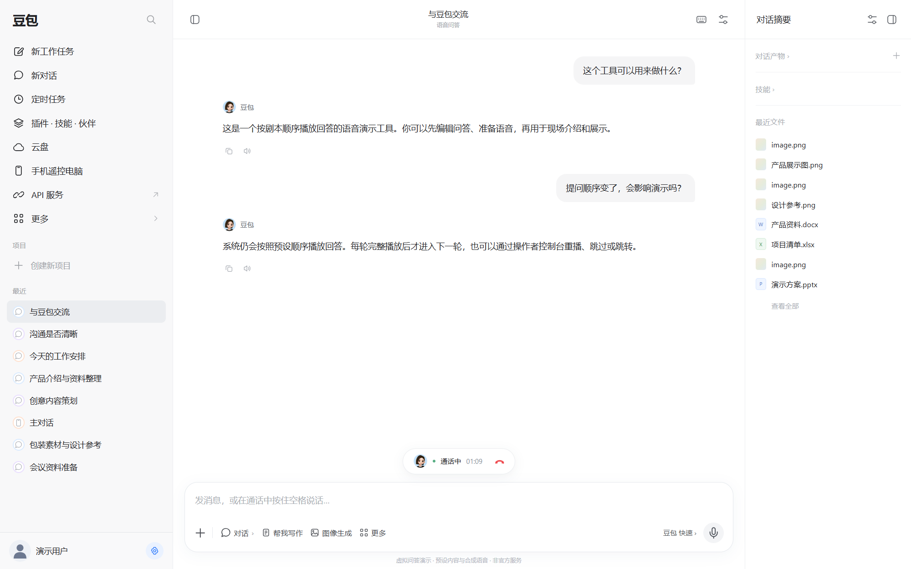
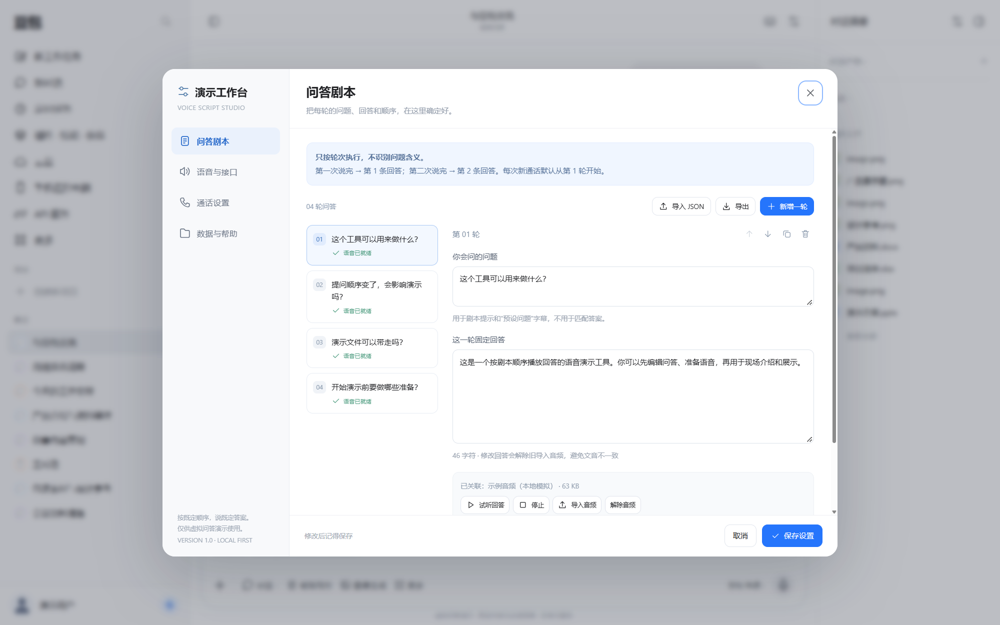
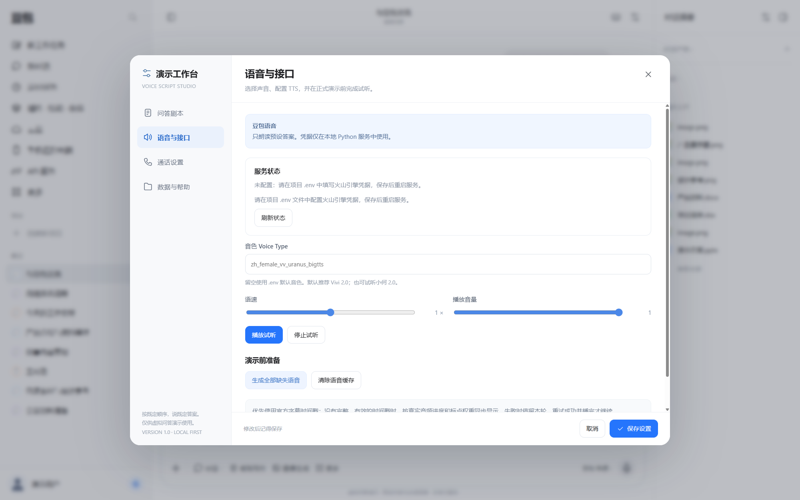
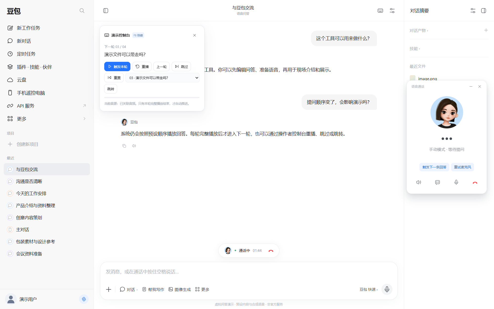

# 豆包虚拟问答演示系统

可编辑问答剧本的本地语音演示工具。按固定顺序播放预先编写的回答，使用火山引擎豆包 TTS 合成语音，支持音频缓存、字幕和现场手动控制。

Local scripted voice demo with Doubao TTS, editable Q&A, audio caching, subtitles, and operator controls.

## 界面预览

以下为实际运行界面的截图，使用通用示例剧本与本地模拟音频；未连接真实 TTS 账号。豆包助手头像保留，个人用户头像和姓名使用通用示例。

### 对话演示

输入问题后，按预先编写的剧本顺序显示和播放回答，适用于产品介绍、活动演示和固定流程问答。



### 问答剧本编辑

在设置中编辑每轮问题和回答，调整顺序，导入剧本或关联已有音频。



### 语音设置

查看本地服务状态，选择音色、语速与播放音量，并在演示前生成缺失语音。真实凭据在本地 `.env` 配置。



### 现场控制

按 F8 打开操作者控制台，可触发、重播、切换或跳转轮次；通话窗口显示豆包头像和当前状态。



## 能做什么

- 在聊天与通话界面中编辑、演示最多 200 轮问答。
- 每次提问触发当前轮回答，完整播放结束后进入下一轮；识别结果用于显示问题，回答顺序由剧本确定。
- 提前批量生成语音、复用缓存、重试失败轮次，也可导入自己的音频。
- 支持字级时间戳字幕，以及时间戳不可用时的播放进度回退。
- 支持上一轮、跳过、跳转、重播、挂断及 F8 控制台，便于现场操作。
- 导出纯剧本 JSON、带音频的备份或独立 HTML。

## 本地启动

需要 **Python 3.10 或更新版本**。应用运行使用 Python 标准库，无需安装第三方 Python 包、Node 或数据库。

1. 下载完整仓库 ZIP 并解压，或通过 Git 克隆仓库。
2. 将 `.env.example` 复制为 `.env`，按需要填写自己的火山引擎 TTS 凭据。
3. Windows 双击 `START_WINDOWS.bat`；也可以运行 `python launch.py`。
4. macOS/Linux 运行 `sh START_MAC.command`，也可运行 `python3 server.py --open`。
5. 保持启动窗口开启，通过 `http://127.0.0.1:8765/` 使用页面。

服务会读取项目目录下的 `.env`，同名进程环境变量优先。修改配置后需重启本项目服务。缺少凭据时仍可打开页面、编辑剧本及导入已有音频。

请通过本地 HTTP 地址使用合成功能。直接双击 HTML 使用 `file://` 地址时，无法连接本地合成接口；已经包含音频的独立 HTML 可播放其打包内容。

## 语音配置

| 配置项 | 用途 |
| --- | --- |
| `VOLCENGINE_TTS_API_KEY` | 自己的火山引擎语音 API Key |
| `VOLCENGINE_TTS_RESOURCE_ID` | 与自己已开通服务及音色对应的资源 ID |
| `VOLCENGINE_TTS_DEFAULT_VOICE` | 默认音色 Speaker / Voice Type，可在页面设置中覆盖 |
| `VOLCENGINE_TTS_SAMPLE_RATE` | 采样率，默认 24000 |
| `VOLCENGINE_TTS_LOUDNESS_RATE` | 合成音量，默认 0 |
| `VOLCENGINE_TTS_APP_ID`、`VOLCENGINE_TTS_ACCESS_TOKEN` | 旧鉴权方式的可选字段；已配置 API Key 时忽略 |

模板中的资源和音色是代码默认示例，能否使用取决于自己的账号权限与服务配置。合成请求可能产生服务费用；请先核对自己的资源、音色和额度，再点击试听或生成。

在设置中保存剧本后，可以生成缺失语音，再进入通话演示。自动触发使用麦克风音量检测；语音转写取决于浏览器支持，也可能由浏览器将音频发送到外部识别服务。首次使用需允许麦克风；可以通过手动模式和控制台进行演示。

## 数据与隐私

- 保留豆包助手头像用于演示识别；用户头像使用通用 SVG 图标，并提供通用用户名和示例问答，不包含私人剧本、个人用户头像或真实凭据。
- 凭据由本地 Python 服务读取；浏览器通过本地接口调用，不接收上游 API Key 或 AccessToken。
- 服务仅监听 `127.0.0.1`，限制 Host、Origin、跨站访问及写接口会话令牌；静态文件白名单不提供 `.env`、源码或日志下载。
- 剧本、显示设置和聊天记录保存在当前站点的浏览器存储中；音频使用 IndexedDB 和本地 `cache/tts/`。
- `.env`、音频缓存、日志及导出目录已加入 `.gitignore`。导出的剧本和独立 HTML 可能包含自己的文字、设置或音频，分享前需检查。
- 清理浏览器数据或更换地址会影响本地记录。请根据需要导出备份。

## 开发与测试

后端模拟测试：

```bash
python -m unittest discover -s tests -v
```

可选的前端测试需要 Node.js：

```bash
node tests/run_frontend_node.cjs
```

浏览器内测试页为 `http://127.0.0.1:8765/tests/frontend.html`，使用独立测试存储与模拟合成接口。自动测试不调用收费 TTS。运行结果与实际限制见 [TEST_REPORT.md](TEST_REPORT.md)。

如需人工验证自己的真实 TTS，可在配置凭据后通过设置页试听，或运行 `python server.py --test-tts`。该命令可能调用收费服务，不属于自动回归测试。

## 项目结构

```text
豆包虚拟问答系统.html     界面、剧本引擎、字幕、缓存及导出
server.py               本地 HTTP 服务和访问控制
tts_provider.py         TTS 请求、错误处理、音频与缓存校验
launch.py               启动及已运行服务检测
START_WINDOWS.bat       Windows 启动入口
START_MAC.command       macOS/Linux 启动入口
.env.example            空白凭据模板
tests/                  后端与前端模拟回归测试
```

## 许可证

MIT，见 [LICENSE](LICENSE)。本项目是独立的演示工具，与豆包、字节跳动和火山引擎没有隶属关系；界面与声音不代表官方客户端。
